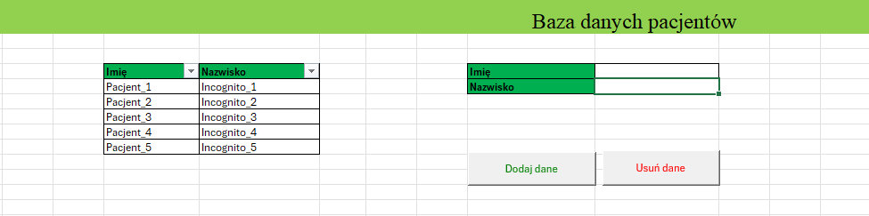
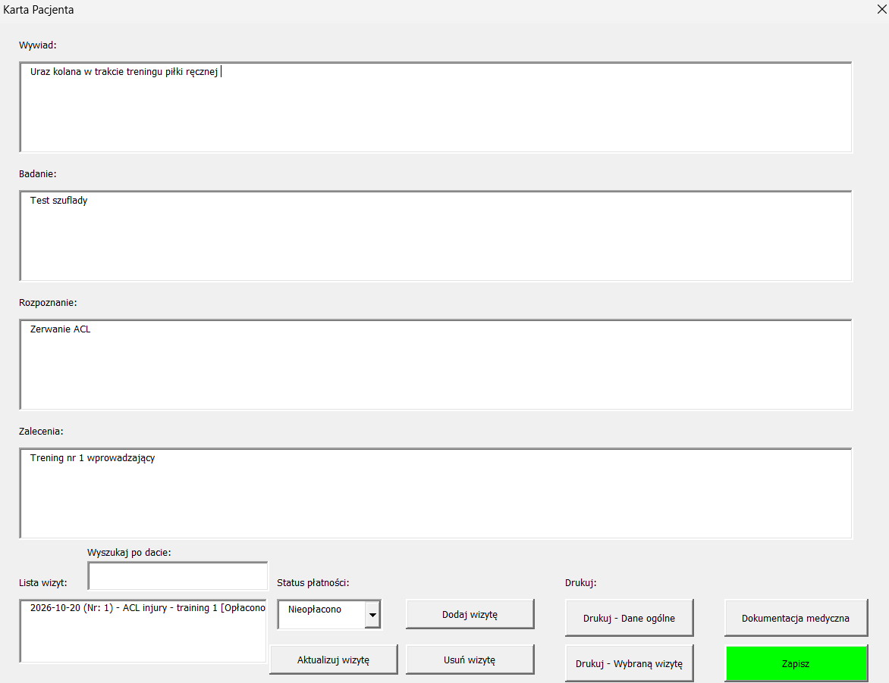
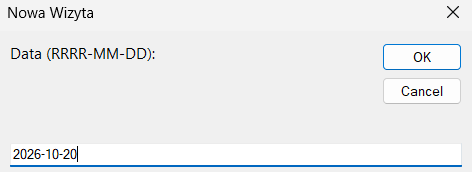
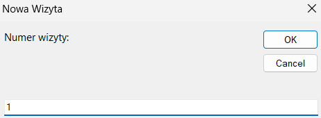
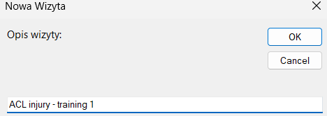
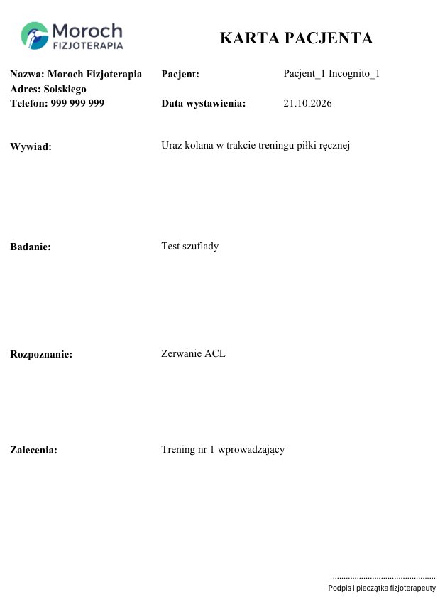
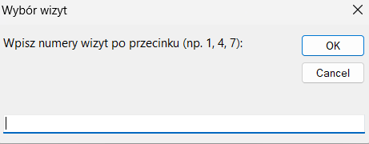
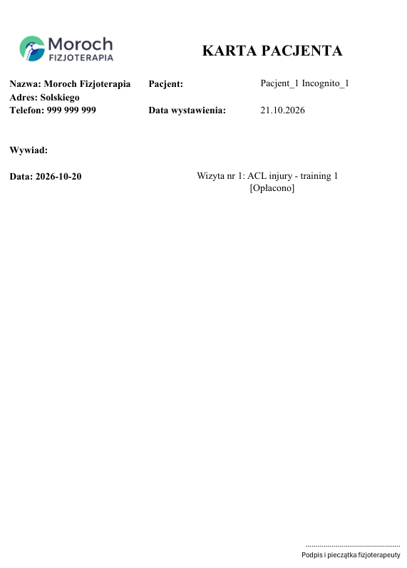

# Physiotherapy management system

Excel VBA application for physiotherapy practice management

## Overview

An Excel VBA application developed to support administrative tasks in a physiotherapy practice. The application uses custom forms and automated processes to help manage patient information and related documentation.

## Key features

### Patient management
- Add, edit, and delete patient records stored in a structured database.
- Automatically create an individual folder for each patient when a new record is added.

### Medical documentation
- Maintain individual patient records, including medical history, examination findings, diagnosis, and recommendations.
- Store and access medical documentation, X-rays, images, PDFs, Word documents, and other files directly from the application.

### Visit management
- Add, edit, and delete individual patient visits.
- Automatically assign visit dates and sequential visit numbers.
- Record visit descriptions and track payment status as paid or unpaid.

### Automated document generation
- Generate printable patient summaries and individual visit records using dedicated Excel templates.
- Automatically populate templates with patient information and selected visit details.
- Include the practice logo and contact information in generated documents.

## Technologies

- **Microsoft Excel** - data storage, worksheets, and document templates
- **VBA** - application logic, automation, and data management
- **Excel UserForms** - graphical user interface for patient and visit management

## Repository structure

- `01_Worksheet_code/` - code associated with worksheets and the workbook
- `02_UserForm/` - user interface forms
- `03_Standard_modules/` - standard VBA modules
- `04_Tool_documentation/` - screenshots and project documentation

## Application screenshots

### Patient database

Central database for managing patient records, providing an overview of registered patients.

  

### Patient card

Individual patient record containing medical history, examination findings, diagnosis, and general recommendations.

  

### Visit management

Forms for creating and managing patient visits, including visit details and payment status.

  

  

  

### Printable documents

Printable patient summary automatically populated with patient information and the practice's contact details.

#### Patient summary

  

#### Visit documentation

Printable visit documentation generated from the information recorded in the application.

  

  

